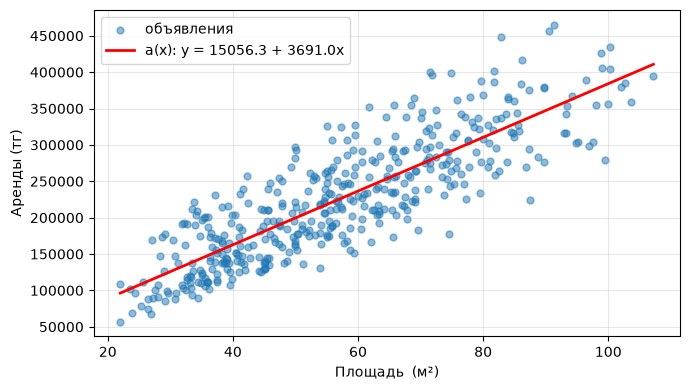
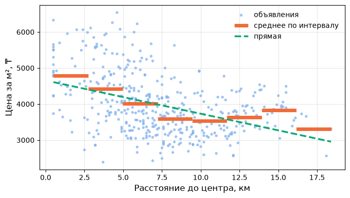
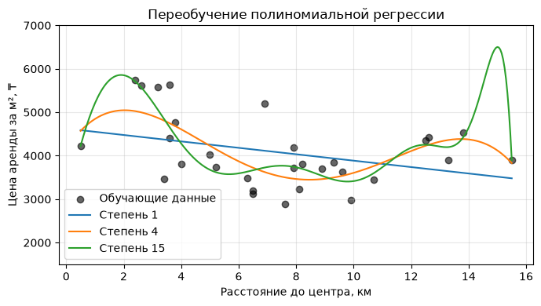
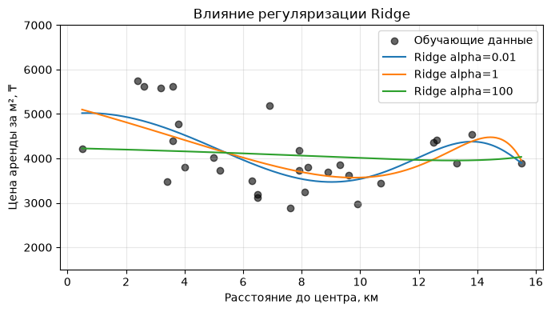
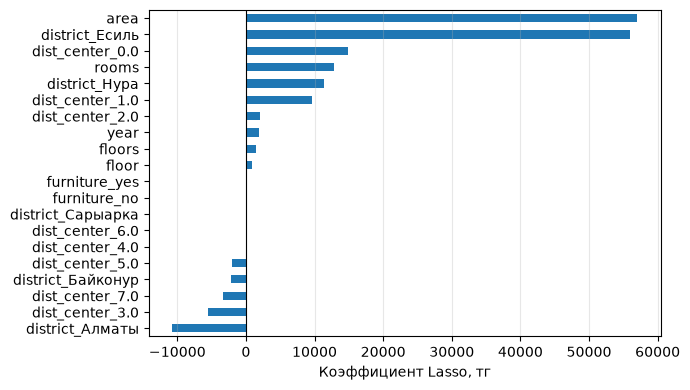
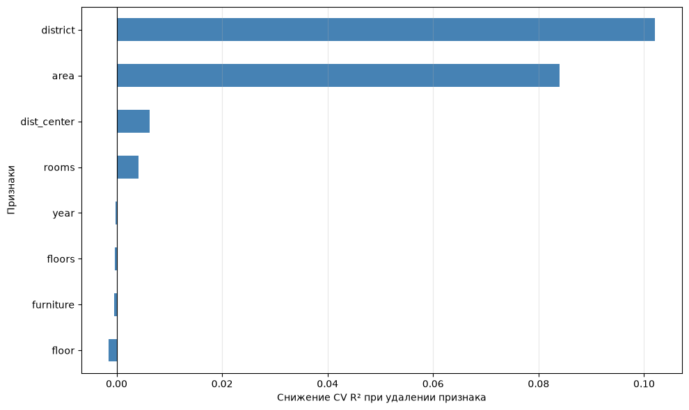

<div align="center">

# 🏙️ Лабораторная работа № 8

### Линейная регрессия: обучение, регуляризация и интерпретация модели

**Воспроизводимый ML-проект: от исследовательского ноутбука до версионированной модели в Git**

`Python` · `NumPy` · `pandas` · `scikit-learn` · `Jupyter` · `Matplotlib` · `Git / GitHub`

**Студент:** Маликов Нурдаулет  
**Тема:** Воспроизводимый ML-проект в Git  
**Специальность:** Прикладная статистика и Data Science  
**Проверил(а):** Тихонова О. А.  
**Репозиторий:** [MalikovNurdaulet/PAD-Lab8](https://github.com/MalikovNurdaulet/PAD-Lab8)

</div>

---

## Навигация

## 📑 Навигация

### 📌 Общая информация
- [1. Цель работы](#1-цель-работы)
- [2. Задачи работы](#2-задачи-работы)
- [3. Описание данных](#3-описание-данных)
- [4. Данные и структура проекта](#данные-и-структура-проекта)
- [5. Запуск проекта](#запуск-проекта)
- [6. Результаты](#результаты)

### 🧪 Практическая часть
- [Шаг 2. Загрузка и разбиение на обучение и тест](#шаг-2-загрузка-и-разбиение-на-обучение-и-тест)
- [Шаг 3. Парная регрессия по формуле](#шаг-3-парная-регрессия-по-формуле)
- [Шаг 4. MSE в векторной форме и качество на тесте](#шаг-4-mse-в-векторной-форме-и-качество-на-тесте)
- [Шаг 5. Множественная регрессия в Pipeline](#шаг-5-множественная-регрессия-в-pipeline)
- [Шаг 6. Нелинейный признак: бинаризация расстояния](#шаг-6-нелинейный-признак-бинаризация-расстояния)
- [Шаг 7. Переобучение и регуляризация на малой выборке](#шаг-7-переобучение-и-регуляризация-на-малой-выборке)
- [Шаг 8. Ridge и Lasso с подбором α](#шаг-8-ridge-и-lasso-с-подбором-α)
- [Шаг 9. Интерпретация: важность через удаление признака](#шаг-9-интерпретация-важность-через-удаление-признака)
- [Шаг 10. Параметры и скрипт обучения](#шаг-10-параметры-и-скрипт-обучения)
- [Шаг 11. Фиксация базовой модели в Git](#шаг-11-фиксация-базовой-модели-в-git)
- [Шаг 12. Эксперимент в отдельной ветке](#шаг-12-эксперимент-в-отдельной-ветке)
- [Шаг 13. Слияние и версия модели](#шаг-13-слияние-и-версия-модели)
- [Шаг 14. Использование модели](#шаг-14-использование-модели)


## 1. Цель работы
Научиться строить, обучать и интерпретировать линейную регрессию в NumPy и scikit-learn: 
получить веса аналитически, оценить качество на кросс-валидации, увидеть переобучение и 
подавить его регуляризацией Ridge и Lasso. Оформить исследование как воспроизводимый 
ML-проект: код, параметры и метрики хранятся в Git, каждый эксперимент проводится в 
отдельной ветке, итоговая модель получает версию. 

## 2. Задачи работы 
– создать Git-репозиторий проекта с понятной структурой, .gitignore и requirements.txt;  
– найти веса парной регрессии по формуле w = (XᵀX)⁻¹Xᵀy и сверить их с LinearRegression;  
– вычислить MSE в векторной форме и оценить качество на тестовой выборке;  
– построить множественную регрессию в Pipeline и оценить её на кросс-валидации;  
– учесть нелинейную зависимость с помощью бинаризации числового признака;  
– воспроизвести переобучение полиномиальной модели и подавить его регуляризацией;  
– подобрать коэффициент регуляризации для Ridge и Lasso, объяснить обнуление весов;  
– оценить важность признаков через их удаление и сравнить с весами модели;  
– перенести обучение из ноутбука в скрипт с файлом параметров и файлом метрик;  
– провести эксперимент в отдельной ветке, сравнить метрики через git diff, выпустить версию модели тегом.  

## 3. Описание данных
Используется учебный датасет `astana_rent_class.csv`, содержащий 600 объявлений об аренде квартир в Астане.

**Целевая переменная:** `price` — стоимость аренды.
Основные признаки:
- `rooms` — количество комнат;
- `area` — площадь квартиры;
- `floor` — этаж;
- `floors` — этажность здания;
- `year` — год постройки;
- `dist_center` — расстояние до центра;
- `district` — район;
- `furniture` — наличие мебели.

## Данные и структура проекта

**Файл данных:** [`data/astana_rent_class.csv`](data/astana_rent_class.csv).

| Характеристика | Значение |
|---|---|
| Объём набора | 600 строк × 13 столбцов |
| Обучающая выборка | 450 объявлений (75%) |
| Тестовая выборка | 150 объявлений (25%) |
| Фиксация разделения | `random_state=42` |
| Целевой признак | `price` — аренда в месяц, ₸ |
| Числовые признаки | `rooms`, `area`, `floor`, `floors`, `year`, `dist_center` |
| Категориальные признаки | `district`, `furniture` |
| Не используются в этой модели | `id`, `date`, `photos`, `rented_14` |

В исходных данных есть пропуски в `area` (18), `floor` (12), `year` (25) и `furniture` (20). Они заполняются **внутри Pipeline**, а не до разделения на train/test. Полных дубликатов строк нет.

```text
PAD-Lab8/
├── assets/
│   └── ...       # скриншоты
├── data/
│   └── astana_rent_class.csv       # учебный набор данных
├── notebooks/
│   └── lab8.ipynb                  # исследование, шаги 2–9 и 14
├── src/
│   └── train.py                    # обучение и сохранение модели
├── models/
│   └── model.joblib                # генерируется локально, не хранится в Git
├── .gitignore
├── params.json                     # параметры текущей версии модели
├── metrics.json                    # метрики текущей версии модели
├── requirements.txt
└── README.md
```

## Запуск проекта
Установить библиотеки:
```bash
pip install -r requirements.txt
```
Запустить Jupyter Notebook:
```bash
jupyter notebook
```
## Результаты

## Шаг 2. Загрузка и разбиение на обучение и тест
### 📊 Результат

```text
(600, 13)
(450, 13) (150, 13)
```

| Выборка | Количество объявлений | Доля |
|---|---:|---:|
| Полный датасет | 600 | 100% |
| Обучающая (`train`) | 450 | 75% |
| Тестовая (`test`) | 150 | 25% |

### 📝 Вывод

Исходный набор из 600 объявлений был разделён на 450 обучающих и 150 тестовых наблюдений.
Фиксация `random_state=42` обеспечивает повторяемость разбиения данных при последующих запусках программы.  

## Шаг 3. Парная регрессия по формуле 
### 📊 Результат
```text
[15056.3  3691. ]
15056.3 [3691.]
```

| Коэффициент | NumPy | LinearRegression |
|---|---:|---:|
| Свободный коэффициент $w_0$ | 15 056,3 | 15 056,3 |
| Коэффициент площади $w_1$ | 3 691,0 | 3 691,0 |

### 📈 Визуализация


### 📝 Вывод
Построена парная линейная регрессия зависимости стоимости аренды от площади квартиры.
увеличение площади на 1 м² соответствует росту прогнозируемой арендной платы примерно на 3 691 ₸ в месяц.
Полученная модель будет использована для дальнейшей оценки качества прогнозирования.


## Шаг 4. MSE в векторной форме и качество на тесте
### 📊 Результат

```text
1894803898 43529
test RMSE 45171 R2 0.768
```

| Метрика | Значение |
|---|---:|
| Train MSE | 1 894 803 898 |
| Train RMSE | 43 529 ₸ |
| Test RMSE | 45 171 ₸ |
| Test R² | 0,768 |

### 📝 Вывод

Парная линейная регрессия объясняет около 76,8% изменчивости стоимости аренды на тестовой выборке.

Среднеквадратичная ошибка прогноза на тестовых данных составляет 45 171 ₸. Близкие значения RMSE на обучающей и тестовой выборках не указывают на выраженное переобучение.

Однако использование только площади квартиры ограничивает точность модели. Для улучшения прогнозирования необходимо учитывать дополнительные характеристики недвижимости.


## Шаг 5. Множественная регрессия в Pipeline
### 📊 Результат

```text
[0.865 0.821 0.878 0.851 0.703] 0.824
test R2 0.871
```

| Метрика | Значение |
|---|---:|
| Числовые признаки | 6 |
| Категориальные признаки | 2 |
| Кросс-валидация | 5 фолдов |
| Среднее CV R² | 0,824 |
| Test R² | 0,871 |

**Основные коэффициенты модели:**

| Признак | Коэффициент |
|---|---:|
| `area` | +57 252 |
| `district_Есиль` | +41 268 |
| `rooms` | +13 014 |
| `district_Нура` | +13 463 |
| `dist_center` | −10 705 |
| `district_Алматы` | −21 733 |

### 📝 Вывод
Среднее CV R² составило 0,824, а Test R² — 0,871. По сравнению с парной регрессией (R² = 0,768) качество прогнозирования значительно улучшилось.

Наибольший положительный коэффициент среди числовых признаков имеет площадь квартиры (+57 252), а расстояние до центра оказывает отрицательное влияние (−10 705). Числовые коэффициенты относятся к стандартизованным признакам.

Таким образом, использование дополнительных характеристик недвижимости позволило повысить точность прогнозирования стоимости аренды.


## Шаг 6. Нелинейный признак: бинаризация расстояния

### 📊 Результат

```text
[0.862 0.816 0.873 0.840 0.700] 0.818
test 0.873
```

| Метрика | Шаг 5: LinearRegression | Шаг 6: Бинаризация |
|---|---:|---:|
| CV R² | 0,824 | 0,818 |
| Test R² | 0,871 | 0,873 |
| Количество интервалов | — | 8 |

### 📈 Визуализация



### 📝 Вывод

Признак `dist_center` был разделён на 8 интервалов одинаковой ширины с помощью `KBinsDiscretizer`.
Среднее значение CV R² составило 0,818, а Test R² — 0,873.
По сравнению с обычной множественной регрессией качество на кросс-валидации немного снизилось с 0,824 до 0,818, хотя на тестовой выборке R² увеличился с 0,871 до 0,873.

Таким образом, бинаризация расстояния не улучшила качество по основному критерию CV R². Исходная модель остаётся предпочтительнее.


## Шаг 7. Переобучение и регуляризация на малой выборке

### 📊 Результат

**Полиномиальная регрессия:**

```text
1 train RMSE 749 test RMSE 763 max|w| 276
4 train RMSE 588 test RMSE 919 max|w| 3.12e+04
15 train RMSE 522 test RMSE 186205 max|w| 1.25e+06
```

| Степень полинома | Train RMSE | Test RMSE | max \|w\| |
|---|---:|---:|---:|
| 1 | 749 | 763 | 276 |
| 4 | 588 | 919 | 31 200 |
| 15 | 522 | 186 205 | 1 250 000 |

**Регуляризация Ridge для полинома степени 15:**

```text
ridge 0.01 train 612 test 975 max|w| 3.58e+03
ridge 1 train 635 test 2387 max|w| 674
ridge 100 train 772 test 772 max|w| 60.6
```

| Alpha (α) | Train RMSE | Test RMSE | max \|w\| |
|---|---:|---:|---:|
| 0,01 | 612 | 975 | 3 580 |
| 1 | 635 | 2 387 | 674 |
| 100 | 772 | 772 | 60,6 |

*RMSE измеряется в ₸/м².*

### 📈 Визуализация

**Переобучение регрессии:**



**Влияние регуляризации Ridge:**



### 📝 Вывод
 Оптимальное значение α следует подбирать с помощью кросс-валидации.


## Шаг 8. Ridge и Lasso с подбором α
### 📊 Результат

```text
ridge alpha 2.593 cv 0.820 test 0.874 zeros 0 of 20
lasso alpha 221.222 cv 0.819 test 0.875 zeros 5 of 20
```

| Метрика | Ridge (L2) | Lasso (L1) |
|---|---:|---:|
| Оптимальное α | 2,593 | 221,222 |
| CV R² | 0,820 | 0,819 |
| Test R² | 0,874 | 0,875 |
| Обнулённые коэффициенты | 0 | 5 |
| Всего коэффициентов | 20 | 20 |

### 📈 Визуализация


### 📝 Вывод
Для моделей Ridge и Lasso выполнен автоматический подбор коэффициента регуляризации α с помощью кросс-валидации.
Ridge уменьшает величину коэффициентов, не обнуляя их, тогда как Lasso обнулила 5 из 20 коэффициентов, выполнив дополнительный отбор признаков.
Обе модели показали сопоставимое качество, однако по CV R² они уступают базовой LinearRegression (0,824).


## Шаг 9. Интерпретация: важность через удаление признака
### 📊 Результат
```text
0.824

district       0.102
area           0.084
dist_center    0.006
rooms          0.004
year          -0.000
floors        -0.000
furniture     -0.000
floor         -0.001
dtype: float64
```

| Признак | Изменение CV R² при удалении |
|---|---:|
| `district` | +0,102 |
| `area` | +0,084 |
| `dist_center` | +0,006 |
| `rooms` | +0,004 |
| `year` | ≈ 0,000 |
| `floors` | ≈ 0,000 |
| `furniture` | ≈ 0,000 |
| `floor` | −0,001 |

### 📈 Визуализация


### 📝 Вывод
Наиболее важными признаками для прогнозирования стоимости аренды оказались район (`district`) и площадь квартиры (`area`). При их удалении качество модели на кросс-валидации снижается на 0,102 и 0,084 соответственно.

Для некоторых признаков изменение CV R² близко к нулю или отрицательно. Это означает, что их удаление практически не ухудшает либо незначительно улучшает качество модели.

Таким образом, величина коэффициента линейной регрессии не всегда отражает реальную важность признака, поскольку признаки могут быть взаимосвязаны.


## Шаг 10. Параметры и скрипт обучения

### 📊 Результат

Созданы файлы `params.json` и `src/train.py` для воспроизводимого обучения модели линейной регрессии.

**Параметры базовой модели (`params.json`):**

```json
{
  "test_size": 0.25,
  "random_state": 42,
  "model": "linear",
  "alpha": 1.0,
  "dist_bins": 0
}
```

**Результат выполнения `python src/train.py`:**

```text
linear {'cv_r2': 0.8237, 'test_r2': 0.8709, 'test_rmse': 33731, 'test_mae': 24970}
```

| Метрика | Значение |
|---|---:|
| CV R² | 0,8237 |
| Test R² | 0,8709 |
| Test RMSE | 33 731 ₸ |
| Test MAE | 24 970 ₸ |

**Созданные файлы:**

| Файл | Назначение |
|---|---|
| `params.json` | Параметры обучения модели |
| `src/train.py` | Скрипт воспроизводимого обучения |
| `metrics.json` | Результаты оценки качества |
| `models/model.joblib` | Сохранённая обученная модель |

### 📝 Вывод

Обучение линейной регрессии перенесено из Jupyter Notebook в отдельный скрипт `src/train.py`. Параметры модели вынесены в `params.json`, а результаты оценки автоматически сохраняются в `metrics.json`.

Среднее CV R² составило 0,8237, Test R² — 0,8709, RMSE — 33 731 ₸, MAE — 24 970 ₸.

Полученные значения соответствуют результатам множественной линейной регрессии из шага 5. Таким образом, обучение модели стало автоматизированным и воспроизводимым.


## Шаг 11. Фиксация базовой модели в Git

### 📊 Результат

После успешного обучения базовой модели файлы `params.json`, `metrics.json` и `src/train.py` добавлены в Git и сохранены отдельным коммитом.

**Команды Git:**

```bash
git status --short
git add params.json metrics.json src/train.py
git commit -m "3. Базовая модель: LinearRegression, cv_r2=0.824"
```

**Результат в истории Git:**

```text
7810959 (main, tag: v1.0) 3. Базовая модель: LinearRegression, cv_r2=0.824
```

| Параметр | Значение |
|---|---|
| Ветка | `main` |
| Хеш коммита | `7810959` |
| Модель | `LinearRegression` |
| CV R² | 0,8237 |
| Сохранённые файлы | `params.json`, `metrics.json`, `src/train.py` |
| Файл модели | `models/model.joblib` — исключён через `.gitignore` |

### 📝 Вывод

Базовая модель LinearRegression зафиксирована в основной ветке `main` отдельным коммитом с указанием значения CV R² = 0,824.

В Git сохранены исходный код обучения, параметры и метрики модели. Обученная модель `model.joblib` исключена из репозитория, поскольку может быть воспроизведена повторным запуском скрипта.

Таким образом, создана контрольная версия базовой модели, с которой можно сравнивать результаты последующих экспериментов.


## Шаг 12. Эксперимент в отдельной ветке

### 📊 Результат

Для проверки влияния регуляризации Ridge и бинаризации расстояния до центра создана экспериментальная ветка `exp/bins-ridge`.

**Команды Git:**

```bash
git switch -c exp/bins-ridge
python src/train.py
git diff metrics.json
```

**Параметры эксперимента (`params.json`):**

```json
{
  "test_size": 0.25,
  "random_state": 42,
  "model": "ridge",
  "alpha": 1.0,
  "dist_bins": 8
}
```

**Результат обучения:**

```text
ridge {'cv_r2': 0.8197, 'test_r2': 0.8737, 'test_rmse': 33372, 'test_mae': 24788}
```

**Сравнение базовой и экспериментальной моделей:**

| Метрика | LinearRegression (main) | Ridge (exp/bins-ridge) |
|---|---:|---:|
| CV R² | **0,8237** | 0,8197 |
| Test R² | 0,8709 | **0,8737** |
| Test RMSE | 33 731 ₸ | **33 372 ₸** |
| Test MAE | 24 970 ₸ | **24 788 ₸** |

**Фиксация эксперимента:**

```bash
git add params.json metrics.json
git commit -m "3.1 Эксперимент: бины dist_center + Ridge cv_r2=0.820"
```

Коммит экспериментальной ветки: `6ae7368`.

### 📝 Вывод

В отдельной ветке `exp/bins-ridge` проведён эксперимент с Ridge-регрессией при α = 1 и бинаризацией расстояния до центра на 8 интервалов.

Тестовое качество модели немного улучшилось: R² увеличился с 0,8709 до 0,8737, а RMSE снизилась с 33 731 до 33 372 ₸.

Однако среднее CV R² уменьшилось с 0,8237 до 0,8197. Поскольку основным критерием выбора модели является качество на кросс-валидации, экспериментальная модель не была признана улучшением базовой.

Эксперимент сохранён в отдельной ветке Git для дальнейшего анализа и воспроизводимости.


## Шаг 13. Слияние и версия модели

### 📊 Результат

После сравнения моделей принято решение оставить базовую LinearRegression в основной ветке `main`, поскольку эксперимент Ridge не улучшил качество на кросс-валидации.

**Команды Git:**

```bash
git switch main
git diff main exp/bins-ridge -- metrics.json
git tag -a v1.0 -m "Модель v1.0"
git log --oneline --graph --decorate --all
```

**Результат истории Git:**

```text
* 6ae7368 (exp/bins-ridge) 3.1 Эксперимент: бины dist_center + Ridge cv_r2=0.820
| * 7810959 (HEAD -> main, tag: v1.0, origin/main) 3. Базовая модель: LinearRegression, cv_r2=0.824
|/
* 7d06705 2.1 переобучение, Ridge/Lasso, важность признаков
* 01f9254 2. парная и множественная регрессия, бины dist_center
* 6d456b6 1.2 README.me updated
* c54b39d 1.1 Project structure, data, py, json
* 3115a16 1. Start lab8
```

| Параметр | Значение |
|---|---|
| Основная ветка | `main` |
| Базовая модель | `LinearRegression` |
| CV R² базовой модели | 0,8237 |
| Экспериментальная ветка | `exp/bins-ridge` |
| CV R² экспериментальной модели | 0,8197 |
| Слияние веток | Не выполнялось |
| Тег версии | `v1.0` |
| Коммит версии | `7810959` |

### 📝 Вывод

По результатам сравнения моделей базовая LinearRegression сохранила преимущество по основному критерию CV R² (0,8237 против 0,8197 у Ridge).

В соответствии с принципами воспроизводимого ML-проекта экспериментальная ветка `exp/bins-ridge` сохранена отдельно без слияния с `main`.

Для базовой модели создан аннотированный Git-тег `v1.0`, фиксирующий версию исходного кода, параметров обучения и метрик.

Таким образом, реализовано версионирование модели с сохранением истории экспериментов в Git.


## Шаг 14. Использование модели
### 📊 Результат
После завершения обучения сохранённая модель `model.joblib` была загружена с помощью библиотеки `joblib` для прогнозирования стоимости аренды квартиры.

**Характеристики квартиры:**
| Признак | Значение |
|---|---|
| `rooms` | 2 комнаты |
| `area` | 60 м² |
| `floor` | 5-й этаж |
| `floors` | 12 этажей |
| `year` | 2015 |
| `dist_center` | 3 км |
| `district` | Есиль |
| `furniture` | yes (с мебелью) |

**Результат прогнозирования:**
```text
283861
```

**Прогнозируемая стоимость аренды: 283 861 ₸/мес.**

### 📝 Вывод
Обученная модель LinearRegression успешно загружена из файла `model.joblib` и использована для прогнозирования стоимости аренды нового объекта недвижимости.

Для двухкомнатной квартиры площадью 60 м², расположенной на пятом этаже двенадцатиэтажного дома в районе Есиль, прогнозируемая месячная стоимость аренды составила **283 861 ₸**.

Полученный результат подтверждает возможность практического применения модели для оценки стоимости аренды квартир на основе их характеристик.

