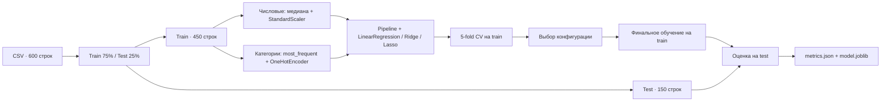

<div align="center">

# 🏙️ Лабораторная работа № 8

### Линейная регрессия: обучение, регуляризация и интерпретация модели

**Воспроизводимый ML-проект: от исследовательского ноутбука до версионированной модели в Git**

`Python` · `NumPy` · `pandas` · `scikit-learn` · `Jupyter` · `Matplotlib` · `Git / GitHub`

**Автор:** Маликов Нурдаулет  
**Репозиторий:** [MalikovNurdaulet/PAD-Lab8](https://github.com/MalikovNurdaulet/PAD-Lab8)

</div>

---

## 📑 Навигация

- [О проекте](#-о-проекте)
- [Данные и структура проекта](#-данные-и-структура-проекта)
- [Методология и Pipeline](#-методология-и-pipeline)
- [Результаты исследования: шаги 1–9](#-результаты-исследования-шаги-19)
- [Сравнение моделей](#-сравнение-моделей)
- [Git, MLOps и шаги 10–13](#-git-mlops-и-шаги-1013)
- [Шаг 14: прогноз цены аренды](#-шаг-14-прогноз-цены-аренды)
- [Запуск и воспроизводимость](#-запуск-и-воспроизводимость)
- [Итоговые выводы](#-итоговые-выводы)

## 🎯 О проекте

**Бизнес-задача.** Построить модель, которая оценивает месячную арендную плату за квартиру в Астане по её характеристикам. Помимо прогноза необходимо объяснить, какие признаки влияют на стоимость, проверить модель на кросс-валидации и обеспечить воспроизводимость результатов.

**Основные задачи ЛР8:** получить веса линейной регрессии методом наименьших квадратов (МНК), рассчитать ошибки, построить `Pipeline`, сравнить модели с бинаризацией признаков, показать переобучение полинома, применить Ridge и Lasso, определить важность признаков и организовать эксперименты через ветки Git.

| Данные | Базовая модель | Качество на 5-fold CV | Качество на тесте |
|:---:|:---:|:---:|:---:|
| **600 объявлений** | **LinearRegression** | **R² = 0,8237** | **R² = 0,8709** |

> **Принцип исследования:** все решения о выборе признаков, параметров и моделей принимаются по кросс-валидации обучающей выборки. Тестовые данные используются для независимой итоговой оценки, а не для подбора модели.

## 📂 Данные и структура проекта

**Файл данных:** [`data/astana_rent_class.csv`](data/astana_rent_class.csv). Это тот же набор наблюдений, что загруженный для работы файл `astana_rent_class(1).csv` (название в репозитории без `(1)`).

| Характеристика | Значение |
|---|---|
| Объём набора | 600 строк × 13 столбцов |
| Обучающая выборка | 450 объявлений (75%) |
| Тестовая выборка | 150 объявлений (25%) |
| Фиксация разделения | `random_state=42` |
| Целевой признак | `price` — аренда в месяц, ₸ |
| Числовые признаки | `rooms`, `area`, `floor`, `floors`, `year`, `dist_center` |
| Категориальные признаки | `district`, `furniture` |
| Не используются в этой модели | `id`, `date`, `photos`, `rented_14` |

В исходных данных есть пропуски в `area` (18), `floor` (12), `year` (25) и `furniture` (20). Они заполняются **внутри Pipeline**, а не до разделения на train/test. Полных дубликатов строк нет.

```text
PAD-Lab8/
├── data/
│   └── astana_rent_class.csv       # учебный набор данных
├── notebooks/
│   └── lab8.ipynb                  # исследование, шаги 2–9 и 14
├── src/
│   └── train.py                    # обучение и сохранение модели
├── models/
│   └── model.joblib                # генерируется локально, не хранится в Git
├── assets/
│   └── readme/                     # диаграммы, скриншоты, скрипт построения
├── .gitignore
├── params.json                     # параметры текущей версии модели
├── metrics.json                    # метрики текущей версии модели
├── requirements.txt
└── README.md
```

## 🧠 Методология и Pipeline



В `Pipeline` предобработка заново обучается на каждом обучающем фолде. Поэтому медианы, масштабы и категории не подсматривают информацию из проверочного фолда или тестовой выборки.

## 📈 Результаты исследования: шаги 1–9

### Шаги 1–2. Подготовка Git и разделение выборки

Инициализирован Git-проект, подготовлены `.gitignore` и `requirements.txt`. Данные разделены с `test_size=0.25` и `random_state=42`:

```python
train, test = train_test_split(df, test_size=0.25, random_state=42)
# df: (600, 13) | train: (450, 13) | test: (150, 13)
```

### Шаги 3–4. Парная регрессия, MSE и R²

Вначале цена предсказывается **только по площади**. Веса рассчитываются через нормальное уравнение МНК и сверяются с `LinearRegression`.

$$
\hat{price} = 15056{,}3 + 3691{,}0 \cdot area
$$

| Показатель | Результат |
|---|---:|
| Свободный коэффициент $w_0$ | 15 056,3 |
| Коэффициент площади $w_1$ | 3 691,0 |
| Train RMSE | 43 529 ₸ |
| Test RMSE | 45 171 ₸ |
| Test R² | 0,7678 |

Для парной регрессии строки с неизвестной площадью исключались: 434 объекта на train и 148 на test. Коэффициенты NumPy и scikit-learn совпадают.


**Интерпретация.** При увеличении площади на 1 м² прогнозируемая аренда возрастает примерно на 3 691 ₸, если оценивать связь в рамках этой простой модели. Одной площади недостаточно для точного прогноза: другие характеристики квартиры тоже важны.

### Шаг 5. Множественная регрессия с Pipeline

К площади добавлены остальные числовые признаки, район и наличие мебели. Используются `SimpleImputer`, `StandardScaler`, `OneHotEncoder` и `LinearRegression`.

| Метрика | Результат |
|---|---:|
| Среднее CV R² (5 фолдов) | **0,8237** |
| Test R² | **0,8709** |
| Test RMSE | **33 731 ₸** |
| Test MAE | **24 970 ₸** |

Множественная модель заметно лучше парной: Test R² вырос с 0,7678 до 0,8709.

### Шаг 6. Бинаризация расстояния до центра

Признак `dist_center` преобразован в 8 интервалов одинаковой ширины через `KBinsDiscretizer(n_bins=8, strategy="uniform")`. Это позволяет линейной модели учитывать ступенчатую зависимость цены от расстояния.


По 5-fold CV **бинаризация не улучшила** модель: CV R² изменился с **0,8237** до **0,8184**. Улучшение отдельной тестовой метрики не является основанием для выбора конфигурации.

### Шаг 7. Переобучение полиномов и Ridge

На 30 объектах обучены полиномы степеней 1, 4 и 15. При повышении степени ошибка train снижается, но модель становится нестабильной на новых данных.

| Степень | Train RMSE, ₸/м² | Test RMSE, ₸/м² | max \|w\| |
|---|---:|---:|---:|
| 1 | 749 | 763 | 276 |
| 4 | 588 | 919 | 31 200 |
| 15 | 522 | 186 205 | 1 250 000 |

*В таблице приведён результат фактического запуска в Jupyter. Для полинома степени 15 число может заметно отличаться между вычислительными окружениями из-за сильной численной неустойчивости.*


Для полинома степени 15 применена L2-регуляризация Ridge:

| α | Train RMSE, ₸/м² | Test RMSE, ₸/м² |
|---|---:|---:|
| 0,01 | 612 | 975 |
| 1 | 635 | 2 387 |
| 100 | 772 | 772 |


Скриншот выполненного ноутбука (реальные результаты шага 7):


**Вывод:** чем сложнее модель, тем выше риск переобучения на малом наборе. Регуляризация уменьшает величину коэффициентов и способна улучшить обобщающую способность.

### Шаг 8. RidgeCV и LassoCV

Значение `alpha` выбирается автоматически в обучающей части; для оценки всего алгоритма применяется внешняя 5-кратная CV.

| Показатель | RidgeCV | LassoCV |
|---|---:|---:|
| Подобранное α | 2,593 | 221,222 |
| Внешний CV R² | 0,820 | 0,819 |
| Test R² | 0,874 | 0,875 |
| Почти нулевых коэффициентов | 0 из 20 | **5 из 20** |

Lasso может **обнулять веса** и тем самым выполнять отбор закодированных признаков; Ridge обычно лишь уменьшает их модуль.


### Шаг 9. Важность признаков через удаление

На каждом повторе один из восьми исходных признаков исключается, Pipeline заново обучается, и вычисляется изменение CV R².

| Исключённый признак | Падение CV R² |
|---|---:|
| `district` | **+0,1020** |
| `area` | **+0,0839** |
| `dist_center` | +0,0062 |
| `rooms` | +0,0042 |
| `year` | −0,0001 |
| `floors` | −0,0004 |
| `furniture` | −0,0004 |
| `floor` | −0,0015 |


**Главные признаки:** район (`district`) и площадь (`area`). Небольшое или отрицательное падение R² означает, что вклад признака невелик или его информация дублируется другими характеристиками. Важность по удалению отличается от абсолютной величины коэффициента регрессии.

## 🏆 Сравнение моделей

Все строки ниже получены на одном CSV с одинаковым разделением данных. Основной критерий — **CV R²**. Указанные значения фиксированных Ridge/Lasso относятся к обучению `train.py`, а в шаге 8 выше приведена вложенная CV для *процедуры подбора* `alpha`.

| Конфигурация | α | Бинов | CV R² | Test R² | Test RMSE, ₸ |
|---|---:|---:|---:|---:|---:|
| **LinearRegression — базовая** | — | 0 | 0,8237 | 0,8709 | 33 731 |
| LinearRegression | — | 8 | 0,8184 | 0,8732 | 33 435 |
| Ridge, эксперимент `exp/bins-ridge` | 1 | 8 | 0,8197 | 0,8737 | 33 372 |
| Ridge, дополнительная проверка | 2,593 | 0 | **0,8239** | 0,8695 | 33 914 |
| Lasso, дополнительная проверка | 221,222 | 8 | 0,8204 | 0,8752 | 33 164 |


> Небольшое улучшение Ridge без бинов (0,8239 против 0,8237) не следует считать доказательством существенного превосходства. Выбор окончательной версии проекта зависит от учебных требований и устойчивости метрик; результаты дополнительных проверок **не означают, что соответствующие ветки уже слиты в Git**.

## 🌿 Git, MLOps и шаги 10–13

### Шаг 10. Воспроизводимый скрипт

В [`src/train.py`](src/train.py) обучение вынесено из ноутбука. Параметры читаются из [`params.json`](params.json); итоговая модель сохраняется как `models/model.joblib`, метрики — в [`metrics.json`](metrics.json).

**Параметры базовой модели (`main`):**

```json
{
  "test_size": 0.25,
  "random_state": 42,
  "model": "linear",
  "alpha": 1.0,
  "dist_bins": 0
}
```

**Метрики базовой модели:**

```json
{
  "cv_r2": 0.8237,
  "test_r2": 0.8709,
  "test_rmse": 33731,
  "test_mae": 24970
}
```

### Шаги 11–13. Коммиты, отдельная ветка и версия

- `main` содержит базовую модель LinearRegression (CV R² ≈ 0,824).
- Ветка `exp/bins-ridge` хранит эксперимент Ridge, `alpha=1`, `dist_bins=8` (CV R² ≈ 0,820).
- Эксперимент **не слит с `main`**, потому что основной показатель CV R² ухудшился.
- Аннотированный Git-тег `v1.0` установлен на коммит базовой модели.

```text
* 6ae7368 (exp/bins-ridge) Эксперимент: бины dist_center + Ridge
| * 7810959 (main, tag: v1.0) Базовая модель: LinearRegression, cv_r2=0.824
|/
* 7d06705 Переобучение, Ridge/Lasso, важность признаков
* 01f9254 Парная и множественная регрессия, бины dist_center
```

*Фрагмент истории Git на момент проверки: позднейшие локальные ветки и коммиты могут отсутствовать в этой записи.*

**Скриншот опубликованного репозитория GitHub:**


Для проверки веток и версий:

```bash
git branch -a
git tag --list
git log --oneline --graph --decorate --all
```

### Что хранится в Git

| Сохраняем в репозитории | Не коммитим |
|---|---|
| `src/train.py`, `notebooks/lab8.ipynb` | `.venv/` |
| `params.json`, `metrics.json` | `__pycache__/` |
| `requirements.txt`, `README.md`, изображения | `models/*.joblib` |
| Учебный CSV, если разрешено заданием | Временные файлы Jupyter |

## 🏠 Шаг 14: прогноз цены аренды

Загружаем сохранённый `Pipeline` и передаём ему признаки квартиры без ручной стандартизации:

```python
import joblib
import pandas as pd

# Запуск из корня репозитория
model = joblib.load('models/model.joblib')
flat = pd.DataFrame([dict(
    rooms=2, area=60, floor=5, floors=12, year=2015,
    dist_center=3.0, district='Есиль', furniture='yes'
)])
print(round(model.predict(flat)[0]))
```

| Признак | Значение |
|---|---|
| Район | Есиль |
| Комнаты | 2 |
| Площадь | 60 м² |
| Этаж / этажность | 5 / 12 |
| Год постройки | 2015 |
| Расстояние до центра | 3,0 км |
| Мебель | Есть |

<div align="center">

### 💰 Прогноз LinearRegression: **283 861 ₸ / месяц**

</div>

*Это пример прогноза на учебных данных, а не рыночная оценка или предложение аренды. Перед запуском шага 14 на базовой модели выполните `git switch main` и `python src/train.py`, чтобы заново сохранить нужный `model.joblib`.*

## 🚀 Запуск и воспроизводимость

Ниже команды для **PowerShell на Windows**:

```powershell
# 1. Получить проект
git clone https://github.com/MalikovNurdaulet/PAD-Lab8.git
cd PAD-Lab8

# 2. Подготовить окружение
py -3 -m venv .venv
.\.venv\Scripts\Activate.ps1
python -m pip install -r requirements.txt

# 3. Проверить версию модели и запустить обучение
git switch main
python src/train.py
Get-Content metrics.json

# 4. Проверить воспроизводимость
git diff -- metrics.json
git status --short
```

При успешном повторном запуске результаты в `metrics.json` должны совпасть с сохранёнными. Команда `git diff -- metrics.json` тогда не выведет изменений. Установленные версии библиотек и вычислительное окружение могут влиять на последние знаки метрик.

Чтобы открыть исследование:

```powershell
python -m pip install jupyter ipykernel
jupyter notebook notebooks/lab8.ipynb
```

Чтобы **пересоздать семь графиков этого README** на данных репозитория:

```powershell
python assets/readme/generate_figures.py
```

## ✅ Итоговые выводы

1. Парная модель по площади объясняет примерно 76,8% вариации цены на тесте; множественная модель — примерно 87,1%.
2. Наиболее важные исходные признаки: район и площадь квартиры.
3. Бинаризация `dist_center` на 8 интервалов **не улучшила** среднюю CV R² для данного CSV.
4. Полином высокой степени на 30 объектах продемонстрировал выраженное переобучение; Ridge уменьшил неустойчивость коэффициентов.
5. Lasso дополнительно зануляет некоторые коэффициенты; при этом сильного улучшения CV относительно базовой модели не получено.
6. Git-ветки позволяют сохранять даже неудачные эксперименты, не ухудшая `main`. Тег `v1.0` фиксирует базовую версию модели.
7. Сохранённый `Pipeline` позволяет повторно обучать модель и получать прогнозы для новых квартир.

---

<sub>ЛР №8 · Линейная регрессия, регуляризация, интерпретация и основы MLOps. Все диаграммы созданы из учебного CSV; скриншоты GitHub и Jupyter взяты из выполненного проекта. Самостоятельная часть методички с отдельным неучебным набором данных в этот README не включена.</sub>
